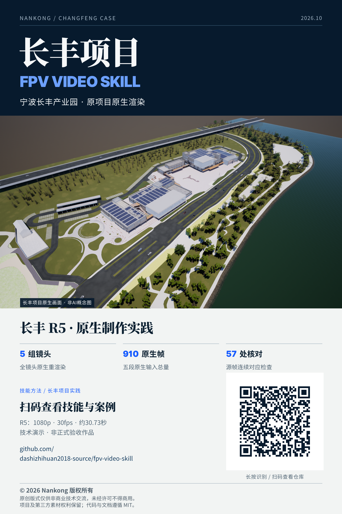

# 穿越机视频skill

让建筑、园区与场景漫游具有穿越机的目标、节奏与空间关系，同时保留可检查的运动、渲染和交付证据。

- 显示名称：**穿越机视频skill**。
- 技能目录与调用名：`skills/fpv-video`、`$fpv-video`。
- 核心入口：[SKILL.md](skills/fpv-video/SKILL.md)。
- 公开过程案例：[长丰案例](examples/changfeng/case.md)，包含失败与待验边界。
- 同事分享：[真实项目一页海报](media/changfeng/poster-v1.3.0.png)（含仓库二维码）及[媒体版权与来源](media/changfeng/README.md)。
- 成果视频：[R5分享压缩版](media/changfeng/changfeng-r5-demo.mp4)，下方直接展示；[参数与验收状态](examples/changfeng/video-status.md)。

本次更新纳入长丰R5的原站材质核验、全场景非树审计、局部地面/法线修复、诊断阴影缓存及新增林带的全镜头原生重渲染方法。现按本次非商业公开展示确认，提供实际长丰项目渲染海报与视频分享版；不是现场航拍，不包含源工程或模型。公开展示不等于正常速度音画与外观人工验收通过。详见[原生场景修复](skills/fpv-video/references/native-scene-repair.md)与[公开分享](skills/fpv-video/references/public-sharing.md)。[视频生视频研究](skills/fpv-video/references/video-to-video-consistency.md)仍为静态研究，未用于R5生成。

## 长丰项目成果视频

技术演示，非正式验收作品。1920×1080 · 30fps · 922帧 · 约30.73秒；此版为有损分享压缩版，音轨保留，原片未改写。播放器不兼容时可[打开或下载MP4](https://github.com/dashizhihuan2018-source/fpv-video-skill/raw/refs/heads/main/media/changfeng/changfeng-r5-demo.mp4)。

<video src="https://github.com/dashizhihuan2018-source/fpv-video-skill/raw/refs/heads/main/media/changfeng/changfeng-r5-demo.mp4" controls preload="metadata" width="960"></video>

配乐：Kinetic by Punch Deck | https://soundcloud.com/punch-deck

Royalty Free Music by https://www.free-stock-music.com

Creative Commons / Attribution 3.0 Unported License (CC BY 3.0)

https://creativecommons.org/licenses/by/3.0/deed.en_US

音乐有截取、音量调整及淡入淡出；作者未为本项目背书。详见[媒体说明](media/changfeng/README.md)。

## 长丰项目分享海报

主视觉直接使用长丰R5原生鸟瞰帧，非AI概念图。技术数据来自既有R5交付，不是此次重新渲染或人工验收证明。保留署名用于非商业同事交流；适用[单独媒体声明](media/changfeng/LICENSE.md)，不改变代码与文档的MIT许可。旧V1.1概念海报仅留存历史，不是本次项目主视觉。



## 使用

将 `skills/fpv-video` 文件夹安装到所用助手支持的技能目录，然后调用：

> 使用 $fpv-video，为我的园区规划一条具有目标与节奏的穿越机航线。先提供新方案供确认，不继承已被否决的旧运镜，不启动正式渲染。

技能不依赖特定 DCC，也不自动安装、启动或接管 Unreal Engine、Blender。原生 API 与版本行为须在实际环境核验。公开分享授权不等于允许上传私有工程或第三方资产。

## 独立合成示例

只需 Python 3 标准库；没有模型、纹理、树、视频、音频或原工程数据。生成器以解析曲线与抽象门洞演示弧长重采样、姿态与边界检查，不会连接 DCC 或网络。

```bash
python3 skills/fpv-video/scripts/synthetic_route.py --output abstract-route.json
python3 -m unittest discover -s skills/fpv-video/scripts -p 'test_*.py' -v
```

输出为独立 JSON 数据，不是 UE/Blender 可直接交付的相机工程。几何数值检查不证明镜头好看、素材可发布或真实场景安全；门洞检查也只针对示例中的直线段与轴对齐开口。

## 发布与授权范围

MIT 仅适用于本仓库新编写的文档与代码。媒体PNG及MP4不适用MIT，按各目录单独声明，仅在权利允许范围用于非商业技术交流；视频中的音乐另按CC BY 3.0。原长丰场景、源模型、NoAI树、贴图、独立音频、原生工程与内部日志均未提供，不因渲染媒体展示而获得源资产、商用或AI处理许可。实际制作请使用自有或明确获授权素材，逐项记录来源和许可证。

已阅读并记录 ETH-ASL、Gyroflow、BlenderPad 的固定版本与源码方法，见[GitHub 方法研究](skills/fpv-video/references/github-methods.md)。仅做方法学习，未安装运行或复制第三方实现，不能称这些外部系统已经在本地调试可用。

© 2026 Nankong 版权所有。本仓库既有原创文档和代码继续按MIT授权，不能将“仅供技术交流”的项目素材边界写成收回MIT商用权。未随包的项目与第三方素材不获新增许可；需要另行核实权利及用途。公开同步前应审核文件白名单、隐私模式、提交元数据和将推送的历史，不能只凭 `.gitignore` 判断安全。
